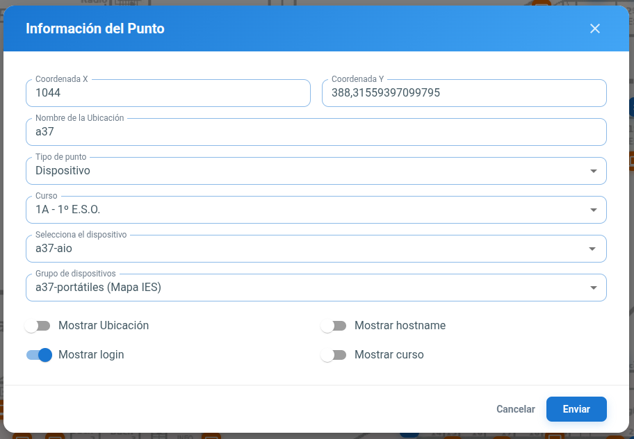
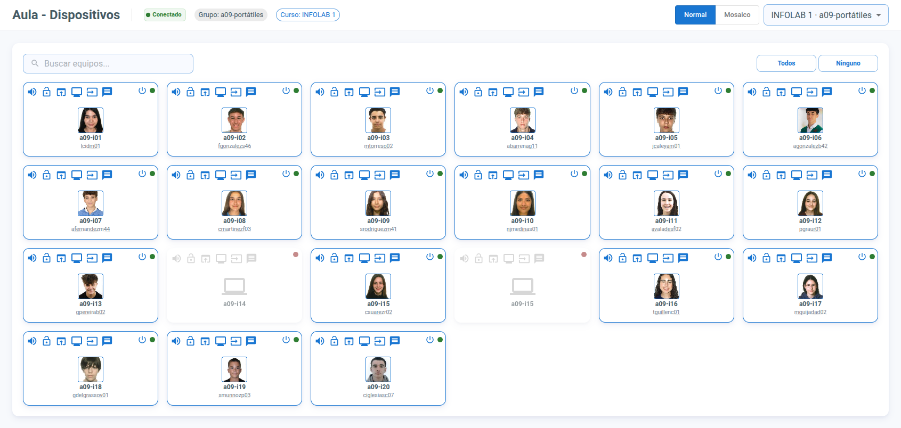
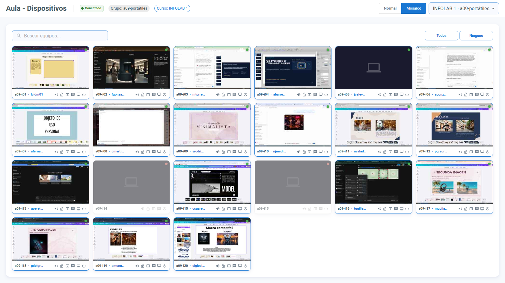

# Panel de Aula para el profesorado

El profesorado y el personal no docente pueden iniciar sesión en EduControl con su usuario y contraseña de LDAP. A diferencia de los administradores, no ven toda la plataforma: únicamente el menú **Aula**, con sus tres secciones (**Dispositivos**, **Asignaciones** y **Alumnos**), y solo con los datos del aula en la que están trabajando en ese momento.

## Quién puede entrar

| Usuario | Acceso |
|---|---|
| Administrador (`admin`) | Acceso completo a EduControl, sin restricciones. |
| Profesorado (grupo LDAP `teachers`) | Solo el menú Aula, limitado a su aula. |
| Personal no docente (grupo LDAP `staff`) | Solo el menú Aula, limitado a su aula. |
| Alumnado (grupo LDAP `students`) | No puede iniciar sesión en EduControl. |

## Cómo sabe EduControl cuál es el aula del profesor

EduControl no asigna aulas a los profesores. El aula se deduce **del equipo en el que el profesor tiene la sesión abierta**: el agente informa de qué usuario ha iniciado sesión en cada equipo, y EduControl busca en el mapa dónde está ese equipo.

Por ejemplo, si un profesor inicia sesión en el all-in-one `a37-aio` y ese equipo está asociado en el mapa al grupo de dispositivos `a37-portátiles`, al entrar en EduControl verá los portátiles de `a37-portátiles`, y ninguno más.

En cuanto el profesor cierra la sesión en el equipo del aula, deja de ver esos dispositivos. Si al día siguiente inicia sesión en el equipo de otra aula, verá los de esa otra.

Si el profesor entra en EduControl sin tener sesión en ningún equipo asociado a un grupo, se le muestra el aviso *"Este equipo no tiene asociado ningún grupo de ordenadores."*

## Configuración del mapa

Para que todo esto funcione, cada aula debe estar configurada en **Configuración > Mapas**. Al editar los puntos del mapa hay que crear dos tipos de punto:

### 1. El grupo de dispositivos

Crea un punto de tipo **Grupo de dispositivos** y añade en él todos los equipos que utiliza el alumnado de esa aula, por ejemplo los ordenadores de un INFOLAB o los portátiles de un aula. Ponle un nombre reconocible, como `a37-portátiles`.

### 2. El dispositivo del profesor

Crea otro punto de tipo **Dispositivo** y selecciona el equipo del profesor de esa aula, normalmente un all-in-one o un Siatic. En ese mismo formulario:

- En **Grupo de dispositivos**, elige el grupo creado en el paso anterior (`a37-portátiles`). Esta asociación es la que hace que el profesor vea esos equipos.
- En **Curso**, elige el curso que da clase en esa aula, si lo hay (por ejemplo `1A`). Es lo que alimenta la sección **Alumnos** del panel.

Con esto ya está listo: cuando el profesor inicie sesión en `a37-aio`, EduControl le mostrará los dispositivos del grupo `a37-portátiles`.

> Un profesor que tenga sesión abierta en un portátil del propio grupo (por ejemplo uno de `a37-portátiles`) también obtiene el acceso a esa aula, siempre que exista el punto de tipo Dispositivo asociado a ese grupo.

## Qué puede hacer el profesor

### Dispositivos

Muestra los equipos del grupo de dispositivos de su aula, con su estado (encendido o apagado), el usuario que tiene la sesión abierta y la batería en el caso de los portátiles. Puede verlos de dos formas:

- **Normal:** una tarjeta por equipo, con la foto y el usuario del alumno que tiene la sesión abierta.

- **Mosaico:** una miniatura en directo de la pantalla de cada equipo.

Sobre los equipos seleccionados puede:

- Silenciar y activar el audio.
- Bloquear y desbloquear el teclado y el ratón.
- Abrir una URL en Chrome.
- Mostrar un mensaje en pantalla.
- Apagar los equipos.
- Ver la pantalla de un equipo por VNC.
- Consultar el historial de sesiones de un equipo.

El profesor **no** puede abrir un terminal, ejecutar comandos libres, ni actuar sobre equipos que no sean de su aula. Estas restricciones se aplican en el servidor, no solo en la interfaz.

### Asignaciones y Alumnos

Estas dos secciones solo tienen contenido si se han asignado los equipos del aula a alumnos concretos, desde **Inventario > Asignaciones**:

- **Asignaciones:** qué equipo tiene asignado cada alumno del aula.
- **Alumnos:** el listado de alumnos del curso del aula, con su foto.

Además, en **Dispositivos**, si un alumno está usando un portátil que no es el suyo, la tarjeta del equipo muestra un **icono rojo de persona tachada**. Al pasar el ratón por encima se indica a quién está asignado el equipo y quién lo está usando.

## Casuística habitual

### Aulas con equipos asignados a alumnos

Es el caso de las aulas de grupo fijo, como las de 1º y 2º de la ESO, en las que cada alumno tiene su portátil. Configura el grupo de dispositivos, el dispositivo del profesor con su **curso**, y asigna cada portátil a su alumno en Inventario. El profesor tendrá toda la información: dispositivos, asignaciones, listado de alumnos y aviso cuando alguien use un portátil ajeno.

### Aulas sin asignaciones (INFOLAB)

En los INFOLAB o aulas por las que pasan alumnos de distintos cursos no tiene sentido asignar equipos a alumnos. **No es necesario**: basta con el grupo de dispositivos y el dispositivo del profesor asociado a él. El profesor verá y controlará los equipos desde **Dispositivos**. Las secciones Asignaciones y Alumnos aparecerán vacías.

### Armarios de portátiles compartidos

Los armarios que van rotando de aula en aula son el caso más complicado. El profesor que usa esos portátiles puede tener la sesión abierta en el equipo de cualquier aula, y EduControl no tiene forma de saber qué armario está utilizando en ese momento: solo ve los portátiles del grupo asociado al equipo del aula en la que está.

Se podría permitir que cualquier profesor viera cualquier grupo de portátiles, pero esa opción **no está disponible a propósito**: supondría que cualquier docente pudiera ver y controlar los equipos de otras aulas.

## Seguridad

- El acceso se decide en el servidor, en cada petición. Cualquier función de EduControl que no sea la del panel de Aula queda denegada para el profesorado, también las que se añadan en el futuro, salvo que se habiliten expresamente.
- Las acciones permitidas se limitan a las enumeradas arriba y siempre sobre los equipos del aula del profesor.
- Las notificaciones en tiempo real (equipos que se conectan, sesiones, batería, miniaturas) se filtran para que cada profesor reciba solo las de su aula.

[Volver](../README.md)
