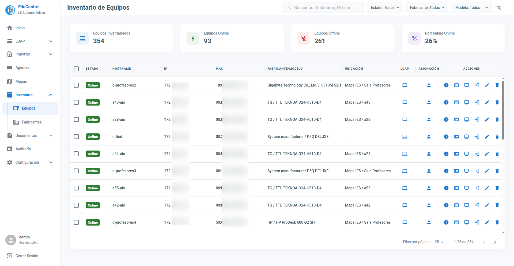
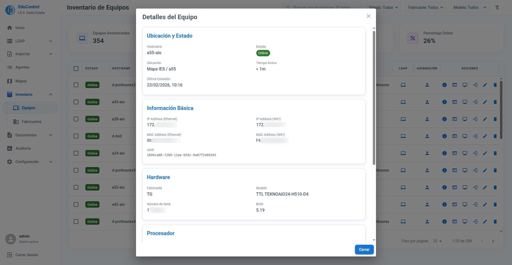

# Módulo de Inventario

El sistema de inventario de EduControl está diseñado para mantener un registro preciso y actualizado de todo el parque informático de forma totalmente automatizada, minimizando la carga administrativa.

## Autoinventariado Dinámico

La gestión del inventario se basa en un proceso de comunicación constante entre los agentes y el servidor central:

### 1. Sincronización al Inicio
Cada vez que un equipo cliente se inicia, el agente local se comunica automáticamente con el servidor de EduControl para realizar un **autoinventariado**. Este proceso recopila información técnica detallada del hardware y la configuración actual del sistema.

### 2. Actualización Inteligente de Datos
El sistema es capaz de detectar si un equipo ya ha sido registrado previamente en la base de datos:
- **Si el equipo es nuevo:** Se crea una nueva ficha de inventario con todos sus detalles.
- **Si el equipo ya existe:** El servidor compara los datos recibidos con los almacenados. Si se detecta cualquier cambio (como una ampliación de memoria RAM, cambio de disco duro o actualización del sistema), la información se **actualiza automáticamente** para reflejar el estado real del equipo en ese preciso instante.

## Base de Datos de Fabricantes

Además de los equipos individuales, EduControl gestiona de forma inteligente una base de datos global de fabricantes:

- **Marcas y Modelos:** Durante el proceso de autoinventariado, el sistema extrae la información de marca y modelo de cada equipo.
- **Normalización Automática:** Si el agente reporta un fabricante o modelo que no existía previamente en los registros globales, el sistema lo **autoinventaría** automáticamente en la base de datos de fabricantes, permitiendo una clasificación y filtrado de todos los recursos del centro.

## Batería de los Equipos Portátiles

Si el agente detecta que el equipo es un **portátil** (por el tipo de chasis del sistema), añade a su ficha de inventario el estado de la batería y lo mantiene actualizado durante toda la sesión:

- **Carga actual:** porcentaje, si está conectado a la corriente y autonomía restante estimada.
- **Salud:** capacidad máxima actual frente a la capacidad de diseño, ciclos de carga y el diagnóstico que ofrece el propio sistema operativo.
- **Identificación:** fabricante, modelo, número de serie y tecnología de la celda.

El estado de carga se envía por WebSocket cada 5 minutos (configurable con `battery_interval` en `agent_config.json`), de modo que la información se refresca sin necesidad de reiniciar el equipo ni de lanzar un inventario completo.

### Visualización

En las tarjetas de equipo (secciones de **Agentes** y **Panel de Aula**) los portátiles muestran un icono de batería con su porcentaje:

- 🟢 **Verde:** carga por encima del 50 %.
- 🟡 **Ámbar:** carga entre el 20 % y el 50 %.
- 🔴 **Rojo:** carga por debajo del 20 %.

Al pasar el ratón por encima se despliega el detalle completo (carga, estado, autonomía, salud, ciclos y capacidad).

Cuando la salud de la batería se degrada aparece además un **icono de aviso** junto al indicador, cuyo tooltip explica el problema concreto detectado: pérdida de capacidad respecto a la original, exceso de ciclos de carga o una advertencia del propio sistema operativo. Así se identifican de un vistazo los portátiles cuya batería conviene sustituir.

## Alumno Asignado en la Pantalla de Inicio

Si un equipo tiene una **asignación activa**, sea de aula o un préstamo (Inventario › Asignaciones), su pantalla de inicio de sesión muestra una tarjeta con la **foto, el nombre y los apellidos** de la persona asignada. Así se ve de un vistazo a quién pertenece cada portátil. Si hay varias asignaciones activas, se muestra la más reciente.

- **Datos:** el nombre, los apellidos y la foto (`jpegPhoto`) se leen del LDAP. Si el LDAP no responde, se usan el nombre y los apellidos guardados en la asignación, sin foto. Si el alumno no tiene foto, se muestran sus iniciales.
- **Cuándo se aplica:** el servidor envía el alumno al agente al crear, editar o eliminar una asignación y cada vez que el agente se conecta. Solo reenvía la foto si ha cambiado. El cambio se ve la próxima vez que aparece la pantalla de inicio (al cerrar sesión o al reiniciar); no se corta la sesión de nadie.
- **Sin asignación:** al cerrar o eliminar la asignación, el agente borra sus ficheros y la pantalla de inicio vuelve a ser la original.
- **Compatibilidad:** LightDM con lightdm-gtk-greeter (Xubuntu/LinEx 22.04 y 24.04). El agente necesita Pillow en su entorno.

Técnicamente, el agente compone un fondo (el fondo configurado más la tarjeta) en `/var/lib/educontrol/login-screen/background.png` y lo aplica con `/usr/share/lightdm/lightdm-gtk-greeter.conf.d/90-educontrol-assigned-user.conf`, con una sección `[monitor: …]` por salida de vídeo. Se hace así porque `/etc/lightdm/lightdm-gtk-greeter.conf` se lee el último y su `background` de `[greeter]` siempre gana. Ese mismo fichero baja un poco la ventana de acceso (`position`) para que no tape la tarjeta.

[Volver](../README.md)
