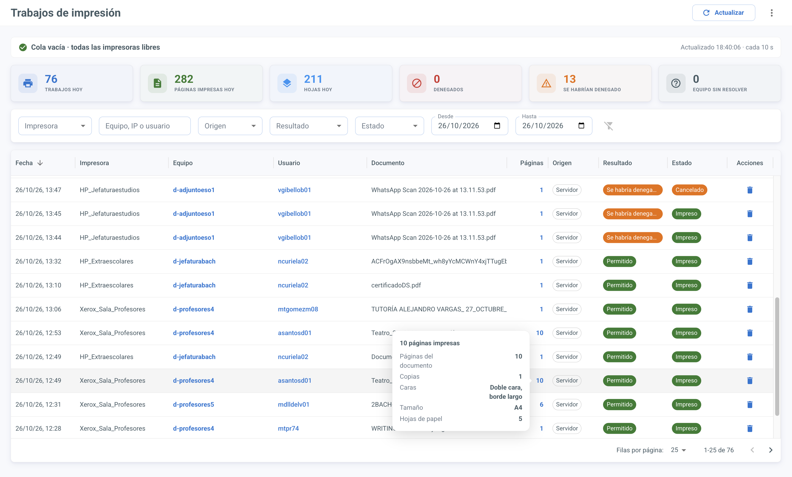
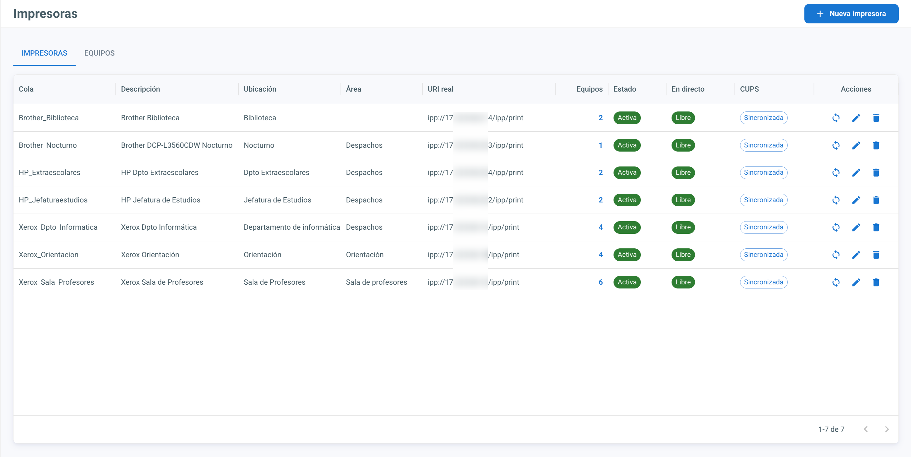
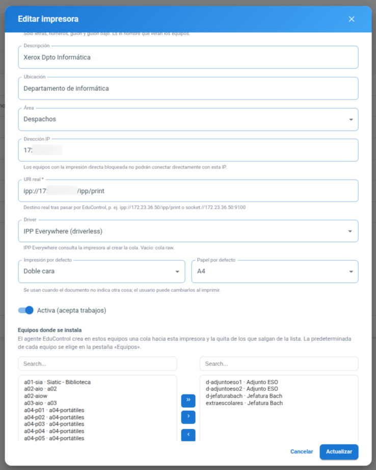
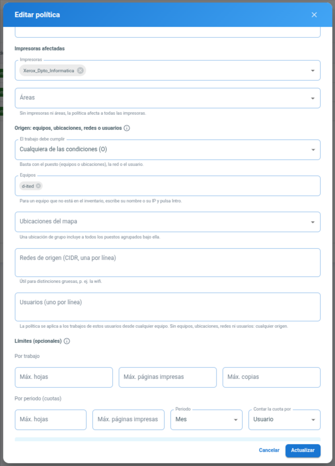
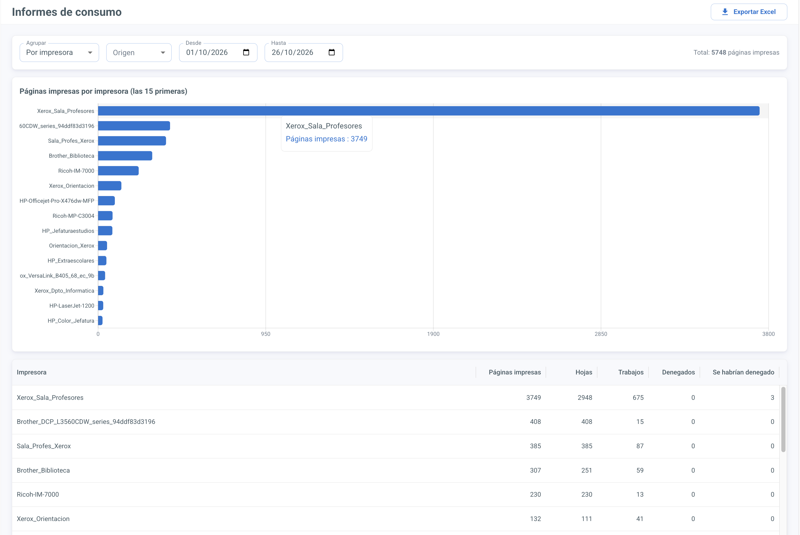
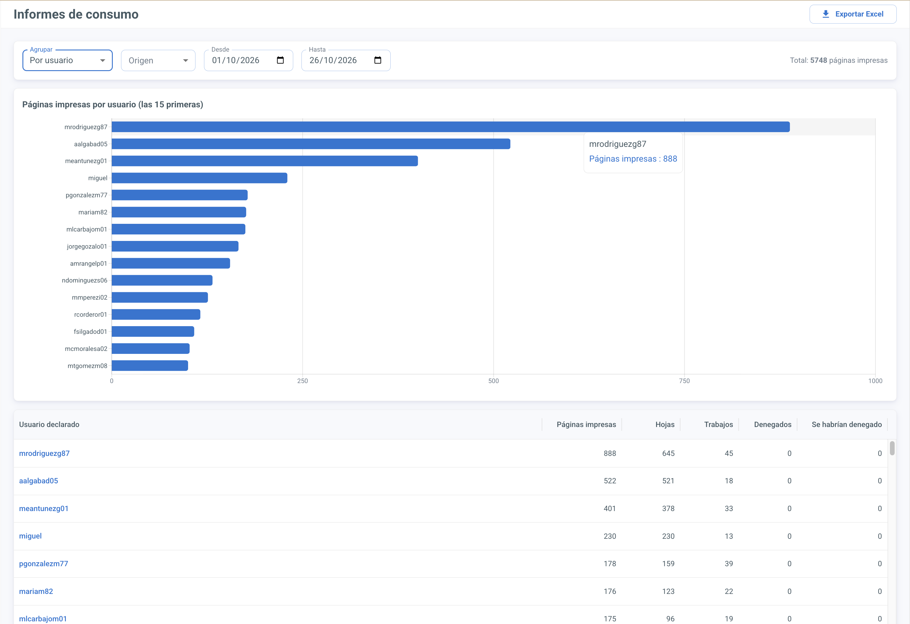
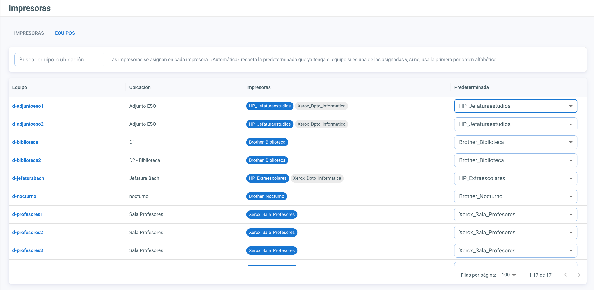

# Impresión centralizada

EduControl puede centralizar la impresión del centro en un servidor CUPS propio. Todos los trabajos pasan por él: se cuentan las páginas y las hojas, se pregunta a EduControl si el trabajo está permitido y, si lo está, se envía a la impresora real. Desde la web se ve en directo qué se está imprimiendo, se cancelan los trabajos atascados, se definen políticas de uso y se consultan informes de consumo por impresora, equipo, usuario o área.

El módulo es **opcional y no destructivo**:

- El contenedor `cups` solo arranca si se activa el perfil `printing` de Docker Compose.
- Mientras el módulo esté desactivado en *Configuración → Impresión*, la API responde «permitido» sin registrar nada.
- Los agentes no tocan la configuración de impresión de los equipos salvo que se active expresamente en cada uno (ver [Agente EduControl](#agente-educontrol-bloquear-la-impresión-directa)).

## Cómo funciona

```
equipo cliente ──IPP──▶ CUPS de EduControl (servidor, puerto 631)
                              │
                              ├─ backend educontrol:// ──▶ API de EduControl: ¿se permite?
                              │                                 │
                              └─ impresora real (ipp:// o socket://) ◀── sí
```

1. El equipo envía el trabajo a una cola del servidor CUPS de EduControl, por ejemplo `Xerox_Sala_Profesores`.
2. Cada cola usa el backend `educontrol://`, que:
   - cuenta las páginas del documento original y calcula las hojas físicas teniendo en cuenta copias, dúplex y páginas por hoja;
   - identifica el equipo de origen por su IP (agentes conectados, inventario o registros DHCP del LDAP);
   - pregunta a la API si el trabajo se permite según las políticas.
3. Si se permite, el trabajo se entrega a la impresora real con el backend estándar de CUPS (`ipp`, `socket`…). Si no, se cancela.
4. Al terminar, el backend comunica el resultado (impreso, error o cancelado) y queda registrado en *Impresión → Trabajos*.

Junto a `cupsd` corre un pequeño servicio, **cups-control**, por el que el backend de EduControl crea y borra colas, regenera `cupsd.conf`, consulta la cola en directo y cancela trabajos. Solo escucha en el propio servidor y en la red interna de Docker, y exige un token.

## Puesta en marcha en el servidor

### 1. Usuario de servicio y token

1. Entra en *Configuración → Tokens API* y genera un token para el usuario `educontrol-print`.
2. Cópialo en la variable `EDUCONTROL_PRINT_TOKEN` del `.env`.

Ese token permite registrar trabajos de impresión en nombre del servidor CUPS. Trátalo como una contraseña. Si se ha expuesto , regenéralo y actualiza el `.env`.

### 2. Variables de entorno

Se definen en el `.env` de `/var/docker/educontrol`, junto al `docker-compose.yaml`.

| Variable | Descripción |
| --- | --- |
| `COMPOSE_PROFILES=printing` | Hace que `docker-compose up -d` arranque también el contenedor `cups`. El script de instalación pregunta si se quiere activar; si no, la deja comentada. |
| `EDUCONTROL_PRINT_TOKEN` | Token del usuario `educontrol-print` (paso anterior). |
| `CUPS_ADMIN_USER` / `CUPS_ADMIN_PASSWORD` | Usuario para entrar en la interfaz web de CUPS (`https://<servidor>:631/admin`). El script de instalación pone `admin` y genera la contraseña: consúltala en el `.env`. |

### 3. Arranque

Con las variables en el `.env`:

```bash
cd /var/docker/educontrol
docker-compose up -d
```

`docker-compose up -d` recrea solo los contenedores cuya imagen o configuración ha cambiado (variables incluidas) y arranca los nuevos, como `cups`. 

El contenedor `cups` usa la red del propio servidor para escuchar en el puerto 631 y ver la IP real de cada cliente. Para comprobar que escucha:

```bash
ss -ltnp | grep -E ':631|:6310'
docker logs educontrol_cups
```

En los registros debe aparecer cups-control escuchando en `127.0.0.1:6310` y `192.168.100.1:6310`.

### 4. Activar el módulo en la web

En *Configuración → Impresión*, activa el módulo, pulsa **Guardar** y después **Sincronizar CUPS** (ver [Configuración → Impresión](#configuración--impresión)).

## Problemas frecuentes en el servidor

### El puerto 631 ya está en uso

Si el servidor tiene instalado su propio CUPS, el contenedor no puede escuchar en el 631 y en `cups_data/log/error_log` aparece un error de puerto en uso. Hay que desactivar el CUPS del sistema (el de EduControl lo sustituye). El script de instalación lo detecta al activar el servidor de impresión y ofrece hacerlo; a mano:

```bash
ss -ltnp | grep :631          # ver qué proceso lo ocupa
systemctl disable --now cups.socket cups.path cups.service cups-browsed
systemctl mask cups.socket cups.path cups.service cups-browsed
docker restart educontrol_cups
```

Hay que desactivar también `cups.socket` y `cups.path`, porque systemd volvería a arrancar `cupsd` en cuanto alguien se conectara al 631.

### «IPP Everywhere driver requires an IPP connection»

El driver *IPP Everywhere* (`everywhere`) genera la configuración preguntando a la impresora por IPP, así que la URI tiene que ser `ipp://` o `ipps://`, por ejemplo `ipp://172.23.36.13/ipp/print`. Con `socket://IP:9100` hay que elegir el PPD de la impresora o dejar el driver vacío. El formulario de impresoras ya lo valida y propone la URI adecuada según el driver.

Antes de usar `ipp://`, comprueba desde el servidor que la impresora tiene IPP abierto:

```bash
ipptool -tv ipp://172.23.36.13/ipp/print get-printer-attributes.test | head
```

### Un trabajo se queda «imprimiendo» y la impresora no recibe nada

Primero, mira el trabajo en *Impresión → Trabajos*: el bloque **En cola ahora** lo marca como atascado a los 5 minutos y permite cancelarlo (ver [Trabajos](#trabajos)). Para diagnosticarlo a mano:

```bash
docker exec educontrol_cups lpstat -t                     # estado de colas y trabajos
docker exec educontrol_cups tail -50 /var/log/cups/error_log
docker exec educontrol_cups cupsctl --debug-logging       # registro detallado (desactivar después)
docker exec educontrol_cups ps -ef | grep -E 'educontrol|ipp://|socket://'
```

Los backends reales de CUPS aparecen en `ps` con la URI de la impresora como nombre de proceso (`ipp://…`), no como `ipp`. Cuando acabes, desactiva el registro detallado con `cupsctl --no-debug-logging`.

Además, *Tiempo máximo por trabajo* (*Configuración → Impresión*, 30 minutos por defecto) hace que CUPS cancele por sí mismo cualquier trabajo que no termine en ese tiempo, para que un atasco nunca bloquee la cola indefinidamente.

## Configuración → Impresión

**Estado del módulo**

- **Módulo de impresión centralizada activo**: activa el registro y la autorización de trabajos y muestra el menú *Impresión*.
- **Aplicar políticas (denegar trabajos)**: mientras esté desactivado, el módulo funciona en **modo observación**. Todos los trabajos se imprimen y se registran, y los que una política habría denegado se marcan como «Se habría denegado». Es la forma segura de probar las políticas antes de aplicarlas.

**Servidor de impresión**

La mayoría de los datos vienen rellenos con lo que EduControl ya sabe:

- **Servidor de impresión**: no se configura. Es la dirección por la que se accede a EduControl, porque CUPS corre en el mismo servidor; se guarda la primera vez que se pulsa *Guardar* y la página la muestra como dato.
- **Redes que pueden imprimir**: se toman de *Configuración → Red* (LDAP). La red INTERNAL es la cableada y la red EDU es la wifi. Cada red se muestra con su origen.
- **Permitir imprimir desde la wifi**: añade la red wifi a las que pueden imprimir.
- **Tiempo máximo por trabajo (minutos)**: CUPS cancela el trabajo que supere ese tiempo (`MaxJobTime`). 0 significa sin límite.

**Opciones avanzadas** (plegadas): redes escritas a mano, que sustituyen a las del LDAP, e IP de administración con acceso a `/admin` de CUPS. Un campo vacío usa el valor automático. La interfaz web de CUPS está siempre en `https://<servidor>:631/` (enlace en *Estado de CUPS*).

**Botones**

- **Guardar** guarda la configuración, pero no toca CUPS.
- **Sincronizar CUPS** regenera `cupsd.conf` con las redes, la IP de administración y el tiempo máximo; lo valida con `cupsd -t` antes de recargar (si no es válido, no se cambia nada y se muestra el error) y vuelve a crear todas las colas. Hay que pulsarlo después de cambiar las redes o el tiempo máximo.

**Bloquear la impresión directa** (antes «Equipos gestionados»): equipos y ubicaciones del mapa que solo pueden imprimir a través del servidor de impresión. El agente instala un cortafuegos en el equipo que impide que dicho equipo pueda enviar trabajos de impresión directamente a las impresoras de red. Las impresoras asignadas a cada equipo se instalan esté o no en esta lista; un equipo de la lista sin impresoras asignadas no podrá imprimir en ninguna impresora de red hasta que se le asigne una (ver [Agente EduControl](#agente-educontrol-bloquear-la-impresión-directa)).

**Estado de CUPS**: indica si cupsd está en marcha, si su configuración la gestiona EduControl y qué colas existen. Incluye el enlace a la interfaz web de CUPS, pensada solo para diagnóstico: las impresoras y la configuración se gestionan desde EduControl, y los cambios hechos allí se pierden al sincronizar.

**Colas locales detectadas**: equipos gestionados cuyo agente ha informado de colas de impresión locales, que permitirían imprimir sin pasar por el servidor.

## Impresión

Con el módulo activo aparece en el menú lateral el grupo *Impresión*, con cuatro pantallas.

### Trabajos

Es la pantalla de trabajo diario. Reúne la cola en directo y el historial.



**En cola ahora** (arriba, se actualiza cada 10 segundos):

- Si no hay nada pendiente, se reduce a una línea: «Cola vacía · todas las impresoras libres».
- Si hay trabajos, muestra cada uno con su impresora, estado, tiempo, equipo, usuario, documento, hojas y el mensaje de la impresora, con el botón **Cancelar**.
- Un trabajo que lleva más de 5 minutos imprimiéndose se marca como **atascado**. Mientras no termine, los trabajos que esperan detrás no salen: cancélalo para liberar la cola.
- Las impresoras con problemas aparecen con sus acciones:
  - **Reanudar**: reactiva una cola que CUPS ha detenido tras un error.
  - **Cancelar todos**: vacía la cola de esa impresora.
- Al cancelar, si el proceso que envía el trabajo a la impresora no termina en 5 segundos, se fuerza su cierre. Así no queda ningún proceso huérfano manteniendo la cola ocupada.
- **Reiniciar CUPS** está en el menú ⋮ de la cabecera. Es el último recurso: interrumpe lo que se esté imprimiendo en todas las impresoras, aunque los trabajos en cola se conservan.

**Historial** (debajo):

- Tarjetas con las estadísticas del día: trabajos, páginas impresas, hojas, denegados, «se habrían denegado» y trabajos cuyo equipo no se pudo identificar.
- Filtros por impresora, equipo o IP, usuario, resultado, estado y fechas.
- Columnas principales:
  - **Equipo** y **Usuario**: al pasar el ratón se ve la ficha del equipo (con acceso a detalles, sesiones y terminal) o la del usuario.
  - **Páginas**: las páginas impresas, es decir, las caras de papel impresas (páginas del documento × copias, agrupadas si se imprimieron varias por cara). Lleva «~» si el formato no se pudo contar y es una estimación. Al pasar el ratón se ve el detalle: páginas del documento, copias, caras (una cara, o doble cara con borde largo o corto), tamaño del papel y hojas de papel gastadas.
  - **Resultado**: la decisión de las políticas (Permitido, Denegado, Se habría denegado o Sin API, si se imprimió con la API caída). Al pasar el ratón se ve el motivo.
  - **Estado**: lo que pasó después: Imprimiendo, Impreso, Error, Cancelado, Denegado o Desconocido. Al pasar el ratón se ve el detalle y la hora de fin.
  - **Acciones**: cancelar el trabajo mientras siga en la cola de CUPS y borrarlo del historial. Un trabajo que se está imprimiendo no se puede borrar. Al borrarlo, sus hojas dejan de contar en los informes y en los límites de las políticas; el borrado queda en la auditoría.
- Cuando un trabajo entra o sale de la cola, el historial se recarga solo.

El estado lo comunica el propio servidor de impresión al terminar cada trabajo. Si algo impide comunicarlo, una tarea periódica (cada 2 minutos) lo concilia con lo que sabe CUPS.

El usuario que aparece es el que declara el equipo cliente: sin autenticación Kerberos no está verificado. Aun así, las políticas pueden aplicarse a usuarios y contar las cuotas por usuario (ver *Políticas*): sirve para repartir cuotas, sabiendo que un usuario podría declarar otro nombre.

### Impresoras

Alta, edición y baja de las impresoras. Cada impresora es una cola del servidor CUPS de EduControl.



| Campo | Descripción |
| --- | --- |
| Nombre de la cola | Nombre que verán los equipos, sin espacios. Por ejemplo, `Xerox_Sala_Profesores`. |
| Descripción, Ubicación | Texto libre. |
| Área | Agrupación usada por las políticas y los informes (por ejemplo, «Departamentos»). |
| Dirección IP | IP de la impresora. Al escribirla se propone la URI real. |
| URI real | Destino real: `ipp://IP/ipp/print` (IPP) o `socket://IP:9100` (puerto RAW). |
| Driver | *IPP Everywhere* (requiere URI `ipp://`), un PPD concreto de la lista o vacío. |
| Impresión por defecto | *Doble cara* (por defecto) o *Una cara*. |
| Papel por defecto | A4 (por defecto), A3, A5 o Legal. |
| Activa | Si está desactivada, sus trabajos se deniegan. |



*Impresión por defecto* y *Papel por defecto* son valores por defecto, no obligaciones: se aplican a los
trabajos que no indican otra cosa y el usuario puede cambiarlos en el diálogo de impresión. Las colas `everywhere` que instala el
agente los copian al crearse, así que si cambias estos valores hay que volver a crear esas colas. En las colas raw (sin
driver) no se aplican, porque no hay filtro que los use: manda el driver del cliente.

Al guardar, la cola se crea o actualiza en CUPS. Si la sincronización falla, la impresora se guarda igualmente y la columna **CUPS** muestra el error. El botón de sincronizar de cada fila lo reintenta.

La columna **En directo** muestra el estado actual de cada cola: Libre, Imprimiendo (con el número de trabajos), Atascada o Detenida. Si CUPS la ha detenido, aparece la acción **Reanudar** en la fila.

### Políticas

Las políticas deciden qué equipos pueden imprimir en qué impresoras y cuánto. Se evalúan **por orden de prioridad** (menor número, antes):

- Si ninguna política cubre una impresora, se permite imprimir en ella.
- Si alguna la cubre, decide la primera que encaje con el equipo de origen.
- Si hay políticas para esa impresora pero ninguna encaja con el equipo, se deniega.

Esta explicación está también en el icono de información junto a la pestaña *Políticas*.

Cada política tiene:

- **Acción**: Permitir o Denegar.
- **Impresoras y Áreas** a las que aplica. Si se dejan vacías, aplica a todas.
- **Origen**: equipos, ubicaciones del mapa (incluidos los puestos agrupados bajo ellas), redes CIDR y usuarios (uno por línea, sin distinguir mayúsculas). Con **«El trabajo debe cumplir: cualquiera (O)»**, basta con que el trabajo cumpla una de las condiciones; con **«todas (Y)»**, tiene que cumplir todas las que estén rellenas. Las condiciones son tres: puesto (equipos o ubicaciones, que cuentan como una sola), red y usuario. Dentro de cada una basta con uno de la lista. Si se dejan todas vacías, aplica a cualquier origen. Por ejemplo, «Permitir en Extraescolares, equipos d-jefaturabach y extraescolares, usuario vgibellob01, todas (Y)» solo deja imprimir a vgibellob01 desde esos dos equipos.
  - **Equipos que no están en el inventario**: en el selector de Equipos se escribe su nombre o su IP y se pulsa Intro (aparecen como «(a mano)»). La IP encaja siempre; el nombre solo si el servidor lo conoce por el registro DNS del LDAP (o si CUPS lo envía como nombre). Un equipo inventariado también encaja si se escribe su nombre.
- **Límites**: por trabajo, máximo de hojas, de páginas impresas y de copias; por periodo (día, semana o mes), máximo de hojas y de páginas impresas. *Hojas* son hojas físicas de papel; *páginas impresas* son caras impresas (páginas × copias): un documento de 10 páginas a dos caras gasta 5 hojas y 10 páginas impresas. Cada límite se comprueba por separado y basta con superar uno para que se deniegue el trabajo; un límite vacío no se aplica.
- **Contar la cuota por**: *Equipo* (cada equipo tiene su cuota, la compartan los usuarios que la compartan) o *Usuario* (cada usuario tiene su cuota, imprima desde el equipo que imprima). Con *Usuario*, un trabajo que llega sin usuario cuenta para la cuota del equipo.



Para dar cuotas distintas a usuarios distintos se crean varias políticas por prioridad. Por ejemplo, «Dirección» (prioridad 10, usuarios `director` y `jefe`, 500 hojas al mes por usuario) y «Resto» (prioridad 50, sin origen, 20 hojas al mes por usuario).

Pestañas:

- **Políticas**: listado y edición.
- **Áreas**: agrupaciones de impresoras.
- **Simulador**: responde a «¿podría imprimir este equipo (o esta IP) en esta impresora un trabajo de N hojas?» con la decisión y el motivo. Úsalo antes de activar *Aplicar políticas*.

### Informes

Consumo agrupado **por impresora**, **por equipo**, **por usuario**, **por área**, **por día**, **por mes** o **por año** entre dos fechas: páginas impresas (páginas × copias, el dato principal), hojas de papel, trabajos, denegados y «se habrían denegado». El gráfico de barras y el total muestran páginas impresas. Las agrupaciones por tiempo se ordenan cronológicamente y el gráfico muestra los periodos más recientes. Por equipo, al pasar el ratón sobre el nombre se ve la ficha del equipo; por usuario, la del usuario. Se puede exportar a Excel. Los datos por usuario son orientativos, por lo explicado arriba.





## Configurar los clientes

El **agente EduControl**: instala en cada equipo las impresoras que le asignes en la web.

1. **Permitirlo en el equipo:** el `agent_config.json` debe incluir `"printing": true`.
2. **Asignar las impresoras:** en *Impresión → Impresoras*, al crear o editar una impresora, se eligen los equipos donde se instalará dicha impresora. Un equipo puede tener varias impresoras.
3. **Elegir la predeterminada** en la pestaña **Equipos** de *Impresión → Impresoras*, puedes elegir la impresora predeterminada de ese equipo. Con *Automática*, el agente mantiene la que ya tenga el equipo si es una de las asignadas y, si no, pone la primera por orden alfabético.

   

Al guardar, el servidor envía la lista de colas a los agentes educontrol de los equipos afectados que estén conectados. Los demás la reciben al conectarse. En cada equipo, el agente:

- crea las colas que falten apuntando a `ipp://SERVIDOR:631/printers/COLA`;
- quita las que dejan de estar asignadas, al desactivar o borrar la impresora o al sacar el equipo de la lista;
- pone la predeterminada;

**Solo toca las colas que ha creado él**, que apunta en `/etc/educontrol/printing-state.json`. Una cola local con el mismo nombre y la misma URI pasa a gestionarla EduControl sin recrearla; el resto de colas locales no se tocan. Las colas creadas por el agente no aparecen como aviso en *Colas locales detectadas*.

### Que el equipo solo vea sus impresoras: desactivar el descubrimiento

El agente instala las impresoras asignadas, pero no impide que el equipo vea otras. Sin más, los diálogos de impresión pueden mostrar muchas más impresoras que las registradas en EduControl, que vienen de dos servicios de descubrimiento:

| Servicio | Qué muestra |
| --- | --- |
| `cups-browsed` | Da de alta por su cuenta colas para las impresoras y servidores CUPS que encuentra en la red |
| `avahi-daemon` | Las impresoras de red que se anuncian por mDNS (IPP Everywhere): los diálogos de impresión las muestran aunque nadie las haya instalado |

Para que el equipo vea **únicamente** las impresoras que le instala el agente hay que desactivar los dos y poner `Browsing No` en su CUPS. Se hace por Puppet con la clase `educontrol_print_client::discovery`:

```puppet
include educontrol_print_client::discovery

# Sin tocar avahi, si el equipo lo necesita para otra cosa:
class { 'educontrol_print_client::discovery': disable_avahi => false }

# Deshacerlo:
class { 'educontrol_print_client::discovery': ensure => absent }
```

La clase completa (`manifests/discovery.pp`):

```puppet
class educontrol_print_client::discovery (
  Enum['present', 'absent'] $ensure        = 'present',
  Boolean                   $disable_avahi = true,
) {

  # El socket de avahi va antes que el servicio: si no, lo vuelve a activar.
  $units = $disable_avahi ? {
    true    => ['cups-browsed.service', 'avahi-daemon.socket', 'avahi-daemon.service'],
    default => ['cups-browsed.service'],
  }

  $path = ['/usr/sbin', '/usr/bin', '/sbin', '/bin']

  if $ensure == 'present' {

    $units.each |String $unit| {
      exec { "educontrol-print-mask-${unit}":
        command  => "systemctl disable --now ${unit} 2>/dev/null; systemctl mask ${unit}",
        unless   => "test \"$(systemctl is-enabled ${unit} 2>/dev/null)\" = masked",
        path     => $path,
        provider => shell,
      }
    }

    # cupsctl reinicia el cupsd local para aplicar el cambio.
    exec { 'educontrol-print-browsing-off':
      command => 'cupsctl Browsing=No',
      onlyif  => 'test -f /etc/cups/cupsd.conf',
      unless  => "grep -Eiq '^[[:space:]]*Browsing[[:space:]]+(No|Off)' /etc/cups/cupsd.conf",
      path    => $path,
    }

  } else {

    $units.each |String $unit| {
      exec { "educontrol-print-unmask-${unit}":
        command  => "systemctl unmask ${unit} && systemctl enable --now ${unit}",
        onlyif   => "test \"$(systemctl is-enabled ${unit} 2>/dev/null)\" = masked",
        path     => $path,
        provider => shell,
      }
    }

    exec { 'educontrol-print-browsing-on':
      command => 'cupsctl Browsing=Yes',
      onlyif  => "grep -Eiq '^[[:space:]]*Browsing[[:space:]]+(No|Off)' /etc/cups/cupsd.conf",
      path    => $path,
    }
  }
}
```

Qué hace:

- **Deshabilita y enmascara** (`systemctl mask`) `cups-browsed` y, si `disable_avahi` es `true`, el socket y el servicio de `avahi-daemon`. Enmascarados, ni una actualización del paquete ni otro servicio pueden volver a arrancarlos. El socket de avahi va antes que el servicio porque, si no, lo volvería a activar.
- **Pone `Browsing No`** en el CUPS del equipo con `cupsctl`, que lo reinicia para aplicarlo.
- **Solo actúa si hace falta**: en un equipo que ya está así no cambia nada.
- **No borra colas ni toca el `client.conf`**: de eso se encarga el agente.

Con avahi parado, el equipo deja de resolver nombres `.local` y de descubrir cualquier dispositivo por mDNS. En un aula gestionada no suele hacer falta; si el equipo lo necesita, usa `disable_avahi => false` (seguirá viendo las impresoras que se anuncian por mDNS).

Para comprobarlo en un equipo:

```bash
lpstat -e      # destinos que verán las aplicaciones: solo deben salir las impresoras asignadas
```

Las aplicaciones que ya estaban abiertas pueden mostrar la lista antigua hasta que se reinicien.

### Al instalar el agente en un equipo

En cuanto el agente se conecta, el equipo recibe las impresoras que tenga asignadas en la web de EduControl y aparecen en sus diálogos de impresión. No hay que hacer nada en el equipo.

**Las impresoras locales que ya estuvieran instaladas se mantienen**: el agente no las borra. Si quieres quitarlas, hazlo a mano en el equipo, como root:

```bash
# Colas del cupsd del equipo y a dónde apuntan
lpstat -h /run/cups/cups.sock -v

# Colas que gestiona EduControl en este equipo (no las borres: el agente las volvería a crear)
cat /etc/educontrol/printing-state.json

# Borrar una cola local, con su nombre exacto
lpadmin -h /run/cups/cups.sock -x NOMBRE_DE_LA_COLA
```

Las que apuntan a `ipp://SERVIDOR:631/printers/...` van por EduControl. Cualquier otra URI (`socket://`, `ipp://` a la IP de la impresora, `usb://`, `hp:/`...) es una cola local que imprime directamente, sin pasar por EduControl. Usa siempre `-h /run/cups/cups.sock`: sin él, si el equipo tiene `client.conf`, `lpstat` y `lpadmin` hablan con el servidor y no con el equipo.

### Agente EduControl: bloquear la impresión directa

Además de instalar las impresoras asignadas, el agente puede impedir que el equipo imprima saltándose EduControl. Requiere un doble consentimiento:

1. El equipo, o su ubicación, debe estar en *Bloquear la impresión directa* (*Configuración → Impresión*).
2. El `agent_config.json` del equipo debe incluir `"printing": true`.

Si se cumplen las dos condiciones, al conectarse el agente:

- Instala una tabla nftables propia (`inet educontrol_print`, en `/etc/educontrol/printing.nft`) que impide imprimir directamente contra las impresoras: bloquea la salida a los puertos 9100, 515 y 631 salvo hacia el servidor, y cualquier tráfico hacia las IPs de las impresoras registradas. Aunque un equipo siga viendo impresoras descubiertas en la red, no podrá imprimir en ellas saltándose EduControl.
- **Solo deja imprimir en las impresoras asignadas al equipo** en EduControl. Si el equipo tiene un `/etc/cups/client.conf` que apunta al servidor de impresión (con él vería todas sus colas), lo retira guardando una copia en `client.conf.educontrol-bak`. Un equipo de la lista sin impresoras asignadas no podrá imprimir en ninguna impresora de red hasta que se le asigne una.
- Informa de las colas locales del equipo, que aparecen en *Colas locales detectadas*. **Nunca borra colas locales** por su cuenta.

La acción *Revertir* elimina la tabla nftables y restaura el `client.conf` que hubiera antes.

### Aviso al usuario cuando se deniega un trabajo

Con *Aplicar políticas* activado, cuando se deniega un trabajo (cuota agotada, límite superado, política que deniega…) el servidor pide al agente del equipo de origen que avise al usuario. El agente abre una ventana con un botón *Aceptar* en la sesión gráfica del usuario que imprimió (si no está, en la de la consola, VT 7), con el documento, la impresora y el motivo. Si el equipo no tiene `zenity`, muestra una notificación de escritorio (`notify-send`). El módulo Puppet del agente instala `zenity` y `libnotify-bin` solo en los equipos con escritorio y los añade a `/etc/pkgsync/mayhave`; en un equipo sin Puppet hay que instalarlos a mano (`apt install zenity libnotify-bin`).

No se avisa en modo observación, si no se ha identificado el equipo de origen o si su agente no está conectado: el trabajo se deniega igual y queda registrado en *Trabajos*.

### Impresoras locales (USB o red directa)

Las impresoras conectadas por USB a un equipo, o instaladas en él apuntando directamente a la impresora (`socket://`, `ipp://` a su IP…), no pasan por el servidor de impresión. Aun así se contabilizan: el agente lee el `page_log` del CUPS del equipo y envía esos trabajos a EduControl, que los muestra en *Impresión → Trabajos* e *Informes* con origen **Local**.

- Solo se envían los trabajos de colas locales. Los de colas que imprimen a través del servidor (las que creó el agente o cuya URI es `ipp://SERVIDOR:631/printers/...`) no, porque ya los registra el servidor y se contarían dos veces.
- No pasan por las políticas ni cuentan para las cuotas: se imprimen sin preguntar a EduControl. Para controlarlas hay que bloquear la impresión directa (ver arriba) o quitar la cola del equipo.
- Solo se registran con el módulo de impresión activo.
- El número de hojas es el que anota CUPS (caras impresas): en una impresora a dos caras puede ser el doble de las hojas reales.
- El agente configura el `page_log` del CUPS del equipo (`PageLog` en `cups-files.conf` y `PageLogFormat` en `cupsd.conf`). Si tiene que reiniciar CUPS para aplicarlo, espera a que no haya trabajos en curso.
- Si el envío falla (servidor caído, sin red), el agente lo reintenta: no se pierden trabajos y EduControl descarta los duplicados.
- Se puede desactivar en un equipo con `"print_tracking": false` en su `agent_config.json`.

El histórico de la antigua *Monitorización → Impresiones* se migró a *Trabajos* con origen **Histórico**. Como entonces no se distinguían las colas locales de las del servidor, puede incluir trabajos que también registró el servidor; por eso no cuenta para las cuotas y se puede filtrar aparte.

## Despliegue por fases

Se recomienda activar el módulo de forma gradual:

1. **Observación con un equipo de prueba.** Módulo activo, *Aplicar políticas* desactivado, una impresora y un equipo configurado a mano. Comprobar en *Trabajos* que llegan los registros, que el estado final es correcto y que las hojas coinciden con el contador de la impresora.
2. **Ampliación.** Más impresoras y equipos, todavía en modo observación. Revisar los trabajos marcados como «Se habría denegado».
3. **Aplicación.** Crear las políticas, probarlas con el simulador y activar *Aplicar políticas*.
4. **Usuarios verificados.** Las cuotas por usuario ya se pueden usar, pero el usuario es el que declara el equipo. Cuando haya autenticación Kerberos pasará a ser fiable.

## Notas técnicas

- **Recuento de páginas**: se hace sobre el documento original del spool. Los formatos que no se pueden contar (por ejemplo, PCL enviado ya convertido) se registran como 1 página con la marca de estimación.
- **Hojas físicas** = `ceil(ceil(páginas / páginas por hoja) / (2 si dúplex)) × copias`.
- **Se respeta lo que pide el cliente**: tamaño de papel, una o dos caras y borde largo o corto. Los equipos con `client.conf` lo envían como opciones del driver (`PageSize`, `Duplex`) y no como atributos IPP (`media`, `sides`); CUPS completaría estos últimos con los valores por defecto de la cola y se ignoraría lo elegido. Por eso el backend `educontrol` da prioridad a `PageSize` y `Duplex` cuando vienen en el trabajo. Los valores por defecto de la impresora solo se usan si el trabajo no indica nada.
- **Carta se imprime en A4**: es la única excepción. Un trabajo en Carta (Letter), lo pida como `PageSize` o como `media`, se envía a la impresora en A4.
- **Hojas horizontales**: borde largo y borde corto se refieren a la hoja de papel. En un documento horizontal, «borde corto» es pasar la hoja como un libro y «borde largo», como un calendario.
- **Reintentos de CUPS**: si CUPS reintenta un trabajo, se reutiliza su registro en lugar de crear uno duplicado.
- **Auditoría**: altas, cambios y bajas de impresoras y políticas, cambios de configuración, cancelaciones, reanudaciones y reinicios de CUPS quedan en el registro de auditoría con el usuario que los hizo.
- **Pruebas del servidor de impresión**: `python3 -m unittest discover -s cups/tests`.
