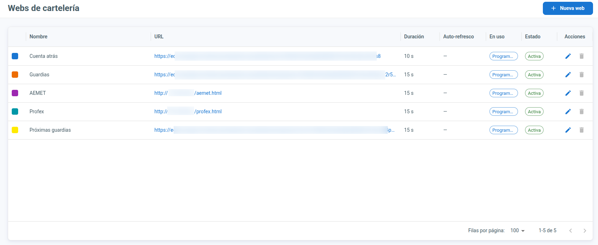
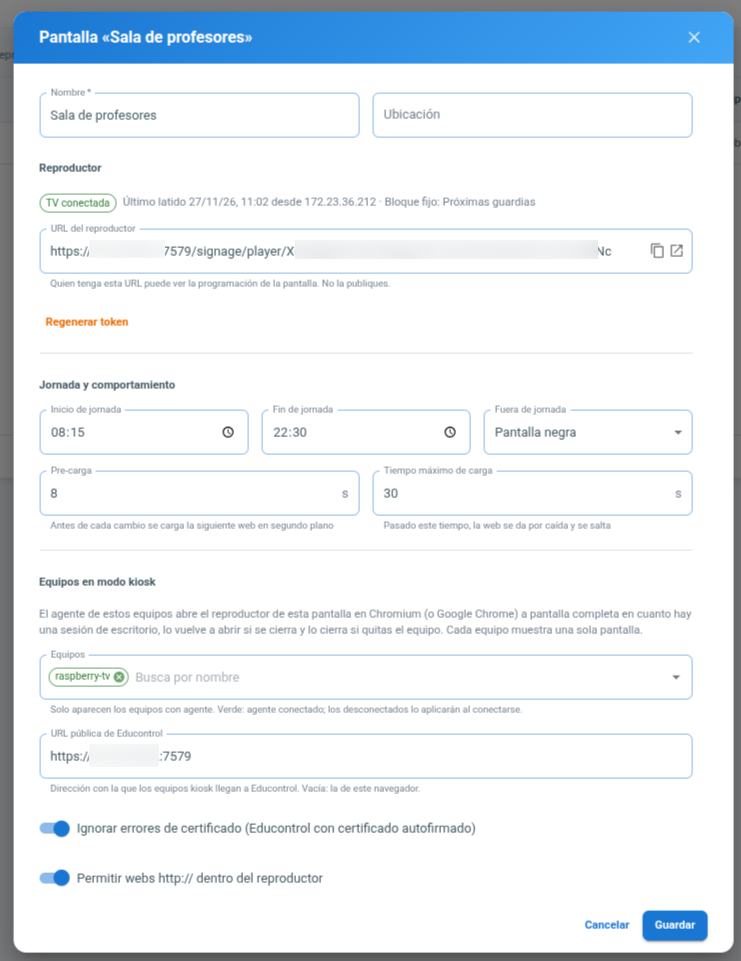
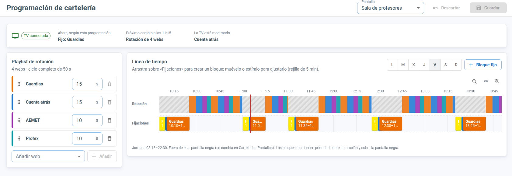

# Cartelería digital

Con la cartelería puedes decidir qué se ve en las televisiones del centro (sala de profesores, conserjería, pasillos…) a lo largo del día: el cuadrante de guardias, el tiempo, avisos, una cuenta atrás…

Cada televisión es una **pantalla**. En cada pantalla se combinan dos cosas:

- **Rotación**: una lista de webs que van pasando una detrás de otra, en bucle, cada una durante los segundos que elijas.
- **Bloques fijos**: franjas horarias en las que se queda puesta una sola web (por ejemplo, las guardias en cada cambio de hora). Mientras dura un bloque fijo, la rotación se detiene.

Los cambios llegan a la televisión en unos segundos, sin tener que tocar nada en ella.

Todo se gestiona desde el menú **Cartelería**, en tres pasos: añadir las webs, crear la pantalla y preparar su programación.

## 1. Añadir las webs

En **Cartelería › Webs** está la lista de todas las webs que se pueden mostrar. Es común a todas las pantallas: una misma web puede salir en varias televisiones.

Pulsa **Nueva web** e indica:

- **Nombre**: cómo la reconocerás en la programación.
- **Dirección (URL)** de la web.
- **Duración**: cuántos segundos se muestra cuando le toca en la rotación.
- **Auto-refresco** (opcional): cada cuánto se vuelve a cargar si se queda fija mucho tiempo. Es útil en webs que cambian a menudo, como el cuadrante de guardias.
- **Color**: el color con el que aparecerá en la línea de tiempo.

El botón **Comprobar** te avisa si la web podría no verse bien en la televisión.

## 2. Crear la pantalla

En **Cartelería › Pantallas** se da de alta cada televisión. Al editarla verás esta ficha:

- **Nombre y ubicación** de la televisión.
- **Estado**: «TV conectada» indica que la televisión está encendida y mostrando la programación.
- **Jornada**: hora de inicio y de fin. Fuera de ese horario puedes elegir que la pantalla se quede **en negro** o que **siga rotando**. Los bloques fijos se muestran siempre, aunque estén fuera de la jornada.
- **Equipos en modo kiosk**: el equipo conectado a la televisión (por ejemplo, una Raspberry Pi). Basta con elegirlo en la lista y guardar: EduControl abre la cartelería a pantalla completa en ese equipo y la vuelve a abrir sola si alguien la cierra o si se reinicia. Si lo quitas de la lista, deja de mostrarla.

Para que un equipo pueda mostrar la cartelería debe tener instalado el agente de EduControl y entrar solo en el escritorio al encenderse. Cada equipo muestra una única pantalla.

La **dirección del reproductor** permite ver la cartelería de esa pantalla en cualquier navegador. No la difundas. Si crees que alguien la tiene sin deber tenerla, pulsa **Regenerar token**: se crea una dirección nueva y los equipos de la televisión la reciben solos.

Normalmente no hace falta tocar el resto de opciones de la ficha.

## 3. Preparar la programación

En **Cartelería › Programación** eliges la pantalla en el desplegable de arriba y preparas lo que se verá en ella.

**Arriba** tienes un resumen: si la televisión está conectada, qué debería verse ahora, cuál es el próximo cambio y qué está mostrando en este momento.

**A la izquierda**, la **lista de rotación**:

- Para añadir una web, elígela en el desplegable **Añadir web** y pulsa **Añadir**.
- Cambia el orden arrastrándolas por los puntos de la izquierda.
- Ajusta los segundos de cada una o quítala con la papelera.

**A la derecha**, la **línea de tiempo** del día elegido (L, M, X, J, V, S, D):

- La fila **Rotación** muestra cómo se irán sucediendo las webs. Las zonas rayadas son los momentos en los que manda un bloque fijo.
- En la fila **Fijaciones** se crean los bloques fijos: arrastra sobre un hueco (o pulsa **Bloque fijo**) para crear uno, arrástralo para moverlo y estira sus bordes para alargarlo o acortarlo.
- Haz clic en un bloque para cambiar la web, los días en los que se repite o para borrarlo.
- Dos bloques no pueden coincidir a la misma hora; si ocurre, se marcan en rojo.
- La línea roja vertical indica la hora actual. Con las lupas puedes acercar o alejar la vista.

Nada cambia en la televisión hasta que pulsas **Guardar**. Si te equivocas, **Descartar** deshace los cambios que no has guardado.

## Preguntas frecuentes

**¿Qué pasa si se va internet o la conexión con EduControl?**
La televisión sigue mostrando la última programación que recibió. Si una web no carga, pasa a la siguiente; si es una web fija, muestra la hora y la fecha hasta que vuelva a funcionar.

**Una web sale en blanco o con un error.**
Algunas webs (Google, redes sociales y muchos portales) no permiten mostrarse dentro de otras páginas. EduControl lo soluciona en los equipos de las televisiones cuando usan el navegador Chromium. También dan problemas las webs que empiezan por `http://`: usa su versión `https://` si existe o activa *Permitir webs http://* en la ficha de la pantalla.

**Una web muestra su propia página de error (por ejemplo, «página no encontrada»).**
Eso viene de la propia web, no de la cartelería. Revisa que la dirección sea correcta.

**¿Tengo que reiniciar la televisión después de cambiar algo?**
No. Los cambios llegan solos en unos segundos.

[Volver](../README.md)
